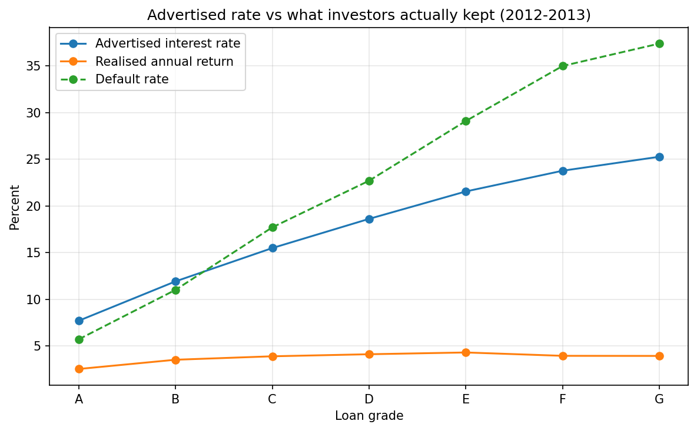
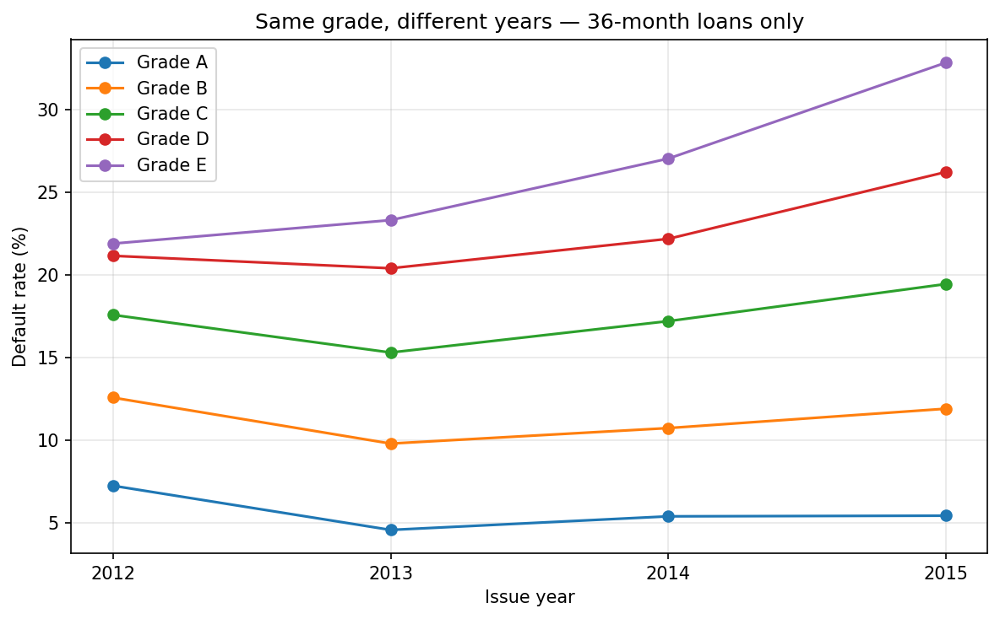
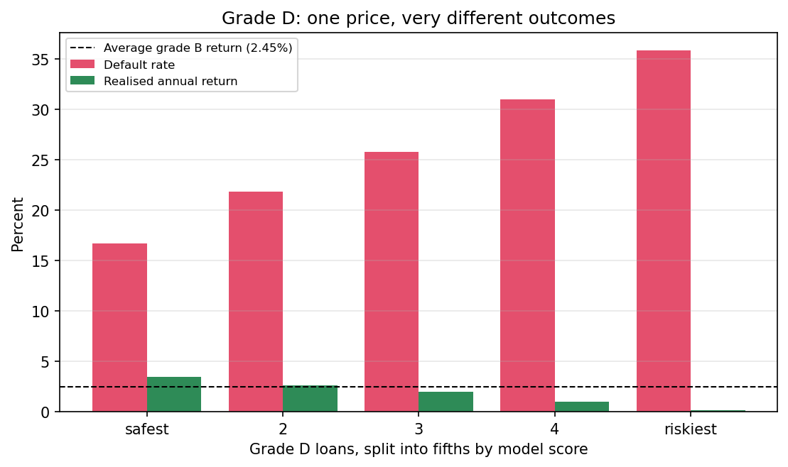

# LendingClub Credit Risk: Grades Are Not a Reliable Price Signal

Analysis of **786,820 matured peer-to-peer loans** issued 2012–2015.

**The finding:** a model using only borrower attributes available at application beats LendingClub's own risk grade on out-of-sample data. Within grade D — where every borrower paid the same interest rate — it separates a subset returning **3.49% annually** from one returning **0.11%**. The safest fifth of grade D outperformed the *average* grade B loan.

---

## Three results

### 1. The risk premium barely compensates



Advertised rates climb from 7% to 26% across grades. Realised returns run from 2.52% to 4.29% — a modest reward for a five-fold rise in default rate.

The larger gap is vertical. Grade A advertises 7.2% and delivers 2.52%, which a 5.7% default rate cannot explain. **Prepayment** does: borrowers repay early without penalty, and capital stops earning.

### 2. Grade letters drifted over time



Restricted to 36-month loans, which are fully matured across the whole period, a grade E borrower defaulted at **23% in 2013** and **30% in 2015**. Same letter, same term, both cohorts fully resolved.

As LendingClub scaled from 43,000 to 283,000 loans a year, the risk behind each letter rose while the label stayed fixed. A grade is not comparable across vintages.

### 3. Borrower attributes beat the platform's grade

| Model | Test AUC (2015) |
|---|---|
| LendingClub's own `int_rate` / `sub_grade` | 0.715 |
| WOE scorecard, borrower features only | 0.718 |
| Gradient boosting, borrower features only | **0.736** |
| Gradient boosting, borrower + platform features | 0.742 |

Adding LendingClub's grade to the model improves it only marginally, indicating their assessment captured little the raw attributes did not.

---

## The commercial case



| Grade D, split by predicted risk | Default rate | Realised annual return |
|---|---|---|
| Safest fifth | 16.7% | **3.49%** |
| Middle | 25.8% | 1.94% |
| Riskiest fifth | 35.8% | 0.11% |

A 3.4-point spread in realised return at a single uniform price. The pattern holds across grades B–E and widens as grade worsens — the platform's assessment was least reliable where the stakes were highest.

At portfolio level, approving the safest 30–50% of applicants returns ~2.71% against ~2.19% for approving all.

---

## Three decisions that shaped the result

**Leakage audit.** Of 151 columns, ~40 record events during or after repayment — payments received, recoveries, settlements. These do not exist when the lending decision is made; including them yields near-perfect accuracy with no predictive value. A further 14 were excluded because LendingClub began collecting them only in late 2015, making their *presence* a proxy for issue date rather than borrower quality.

**Completed-cohort window.** Loans issued after 2015 are mostly unresolved by the data cutoff, and the ones that *have* resolved finished early — either prepaid or defaulted fast. Including them measures only unusual loans. Pricing analysis uses 2012–2013, where both loan terms are 100% matured; modelling uses 2012–2015.

**Time-based validation.** Train 2012–2014, test 2015 — not a random split. Default rates rose from 17.2% to 20.2% across that boundary, so a random split would let the model learn the harder period's conditions in advance and overstate performance.

---

## What this does not show

**It does not support lending to more people.** Every loan analysed already passed LendingClub's approval filter. Outcomes for rejected applicants are unobservable, so the finding is about choosing better among the already-approved — not about extending credit further.

**Defaults are partial losses.** Charged-off loans recover 33% of principal on average; only 0.1% of defaulters paid nothing. Loss is roughly 38 cents per dollar lent.

**No recession in the data.** 2012–2015 was a benign credit environment. Credit models typically degrade most under stress.

**Returns are simplified.** Annualised without discounting within-loan cash flows, and servicing fees are excluded, overstating all returns by a similar margin.

---

## Reproducing

**Data.** Download `accepted_2007_to_2018Q4.csv.gz` (~375 MB) from the [All Lending Club loan data](https://www.kaggle.com/datasets/wordsforthewise/lending-club) dataset on Kaggle. Place it in the repository root. It is gitignored — too large for GitHub.

**Environment.**
```bash
pip install pandas numpy matplotlib scikit-learn pyarrow
```

**Run in order:**

| Notebook | Contents | Runtime |
|---|---|---|
| `01_load_audit_pricing.ipynb` | Load, window selection, pricing analysis, grade drift, leakage audit, EDA | ~5 min |
| `02_modelling.ipynb` | Time-based split, WOE scorecard, gradient boosting, profit curve, within-grade analysis | ~15 min |

`MEMO.md` is the one-page summary written for a non-technical reader.

---

## Notes on method

**Weight of evidence** encodes each variable bin as `ln(share of good loans / share of bad loans)`. Negative is riskier than average, positive is safer. Bins are fitted on training data only. Information value ranks variables; anything below 0.02 is dropped. The resulting scorecard is a points table — a declined applicant can be told which factors cost them, which a gradient-boosted ensemble cannot provide.

**Two models, not six.** The scorecard answers "what can be deployed in a regulated lending context"; gradient boosting sets the practical ceiling on these features. The gap between them (0.718 vs 0.736) is the measured cost of interpretability. Additional algorithms would land between the two without changing any conclusion.

**One engineered feature.** `earliest_cr_line` is a date string with hundreds of values, useless as a category. The interval between it and the loan date is credit history length — median 14.8 years — a standard credit variable.

**Missingness was diagnosed, not imputed.** `mths_since_last_delinq` is blank for half the sample, and 99.5% of those blanks belong to borrowers with zero delinquencies. The field is empty because the event never occurred, so it is encoded as a flag plus a sentinel rather than filled with a guess.

---

## Curiosity from the EDA

Borrowers whose income LendingClub **verified** defaulted at **21.5%**; those whose income went unverified defaulted at **13.5%**.

Verification did not make borrowers worse. LendingClub verified selectively, demanding documentation when an application looked suspicious. The column therefore records the lender's suspicion rather than the borrower's honesty — a feature measuring the wrong subject.
